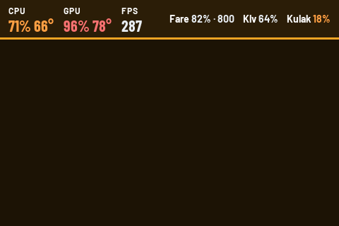

# Sabasakal Mini Screen 3.5″

Sürüm 1.1.3

1.1.3 düzeltmeleri: CPU, GPU ve RAM değerleri Windows Görev Yöneticisi ile
aynı (1 sn sayaçlar, ek ortalama yok, GPU = en yoğun motor türü, RAM
"kullanımda" tek ondalık). CS2 açık ama maç verisi yokken (menü, yükleme)
Claude tasarımı masaüstü yerine sistem bilgisi ve eşleştirme pingleri olan bir
CS2 ekranı gösterir; CS2 eski GSI ayarıyla çalışıyorsa "CS2'yi yeniden başlat"
uyarısı çıkar. Oyun içi performans modu: ses yakalama durur, pil taraması
seyrekleşir, öncelik düşer, sensör yardımcısı anakart SuperIO okumaz. İptal
edilen pil taraması bilinen cihazları gizlemez.

1.1.2 düzeltmeleri: "Kaydet ve başlat" artık seçilen tasarımı, ekran yönünü ve
diğer ayarları ekran başlamadan önce gerçekten kaydediyor (1.1.1'de bir Qt
sinyal argümanı kaydı atlatıyordu). Tasarımların adı artık Claude (varsayılan)
ve Codex; MSFS görünüm seçicisi yalnızca Codex'te görünür, Claude tek şehir
(ilk şehir kutusu) için hava durumu gösterir, Codex üç şehri korur. Ekran yönü
ekran çalışırken de değiştirilebilir.

1.1.1 düzeltmeleri: "Ekran" kartındaki seçiciler artık üst üste binmiyor,
180° ekran yönü LCD'de gerçekten uygulanıyor (iki tasarımda da, USB yeniden
bağlandığında da; döndürme yazılımla yapılır) ve Yeni/Klasik tasarım seçimi
başlatıldığında hemen geçerli oluyor. Testler artık tamamen izole çalışır
(geçici profil, gerçek donanım/zamanlanmış görev yok).

Windows üzerinde 480×320 USB mini ekranlar için hazırlanmış modern bir bilgi
panelidir. İşlemci, harici ekran kartı ve RAM değerlerinin yanında CS2, MSFS
2024, medya, hava durumu ve kablosuz cihaz pil bilgilerini gösterebilir.

Hazır paketi kullanmak için son GitHub sürümündeki
`Sabasakal-Mini-Screen-3.5.zip` dosyasını indirin, normal bir klasöre çıkarın ve
`Sabasakal-Mini-Screen.exe` dosyasını çalıştırın. Dil seçimi sağ üsttedir.
ZIP içinden çıkan `_internal` klasörünü EXE'nin yanında bırakın. Bu taşınabilir
klasör yapısı geçici `_MEI` klasörü oluşturmadığı için açılış ve temizlik
hatalarını önler.

CS2 tarafında yalnızca Valve Game State Integration ile oyunun kendi yerel
konsol/ağ bilgisini kullanır. Oyun belleğine erişme, kod enjekte etme, giriş
otomasyonu veya paket yakalama yapmaz.

1.1.0 ile gelenler:

- Kontrol panelinden seçilebilen iki ekran tasarımı: **Claude** (varsayılan) ve
  **Codex**.
- FACEIT güvenlik modu: FACEIT Anti-Cheat çalışırken Game State Integration
  dinleyicisi kapatılır, yalnızca sistem panelleri gösterilir.
- Bomba sayacı kaldırıldı.

Ayrıntılı özellikler, kaynak derleme adımları ve lisans bilgileri için
[İngilizce ana belgeye](README.md) bakabilirsiniz.
