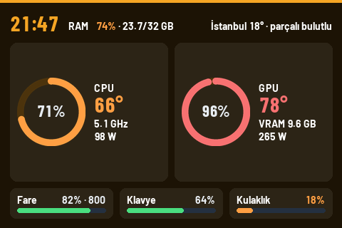

# Sabasakal Mini Screen 3.5″

Sürüm 1.1.11

1.1.11 değişiklikleri: saniyede yaklaşık 1 MB büyüyen bellek sızıntısı
giderildi (Windows pil taraması her cihazın WinRT özellik tablosunu
kopyalıyordu; bu yerel bellek sızdırıyordu ve bir günde onlarca GB'a
ulaşabiliyordu); tam Windows cihaz taraması en fazla 10 sn'de bir yapılıyor;
G HUB bağlantıları bellekte birikmiyor; kontrol panelindeki bozuk Türkçe
karakterler düzeltildi (1.1.9'da gui.py yanlış kodlamayla kaydedilmişti).
CS2 oyun verisi özellikleri (Game State Integration, ekonomi, ölüm maçı ve
round ekranları, eşleştirme/FACEIT pingleri, uyarı katmanı, G HUB CS2
profili DPI uyarısı) kaldırıldı. CS2
açıkken normal masaüstü ekranı yalnızca CS2'nin turuncu temasıyla çizilir.

1.1.6 düzeltmeleri: mini ekran çıkarılıp takılınca uygulama yeniden
başlamadan bağlanıyor; sensör/çizim hatası USB oturumunu sıfırlamıyor; ekran
çıkarılmışken durdurmak paneli yeniden açmıyor; MSFS yeniden başlatılınca
sahte iniş kaydı ve eski yakıt/telsiz/rota verisi yok; G HUB hatası pil
listesini dondurmuyor; silinen hava durumu şehirleri hemen kalkıyor; Codex
tasarımında uzun cihaz ve şehir adları sığdırılıyor.

1.1.5 düzeltmeleri: kapatılan kablosuz kulaklık/fare (USB alıcı takılı kalsa
da) birkaç saniye içinde ekrandan kalkıyor; ilk sensör başlatması artık
yeniden başlatma olarak günlüğe yazılmıyor; eski kopyayı gösteren başlangıç
görevi onarılıyor veya siliniyor; `--quit` çalışan uygulamayı düzgünce kapatıyor.

1.1.4 düzeltmeleri: Windows pil taraması artık Windows'un zaman zaman iptal
ettiği 30-60 sn'lik AssociationEndpoint taramasını yapmıyor (E_ABORT günlük
satırları bitti); CPU sensör yardımcısı, oyun yükünde LibreHardwareMonitor
yavaşlasa da önbelleği sabit 1 sn aralıkla yazıyor; Claude tasarımındaki satın
alma (para/FULL BUY/ECO/FORCE) ekranı kaldırıldı (freezetime canlı round
ekranını gösterir); ekran geçişleri kararlı istek bekler (en az 2,5 sn) ve
büyük değişimler soldan sağa silme efektiyle gönderilir.

1.1.3 düzeltmeleri: CPU, GPU ve RAM değerleri Windows Görev Yöneticisi ile
aynı (1 sn sayaçlar, ek ortalama yok, GPU = en yoğun motor türü, RAM
"kullanımda" tek ondalık). CS2 açık ama maç verisi yokken (menü, yükleme)
Claude tasarımı masaüstü yerine sistem bilgisi ve eşleştirme pingleri olan bir
CS2 ekranı gösterir; CS2 eski GSI ayarıyla çalışıyorsa "CS2'yi yeniden başlat"
uyarısı çıkar. Oyun içi performans modu: ses yakalama durur, pil taraması
seyrekleşir, öncelik düşer, sensör yardımcısı anakart SuperIO okumaz. İptal
edilen pil taraması bilinen cihazları gizlemez.

1.1.2 düzeltmeleri: "Kaydet ve başlat" artık seçilen tasarımı, ekran yönünü ve
diğer ayarları ekran başlamadan önce gerçekten kaydediyor (1.1.1'de bir Qt
sinyal argümanı kaydı atlatıyordu). Tasarımların adı artık Claude (varsayılan)
ve Codex; MSFS görünüm seçicisi yalnızca Codex'te görünür, Claude tek şehir
(ilk şehir kutusu) için hava durumu gösterir, Codex üç şehri korur. Ekran yönü
ekran çalışırken de değiştirilebilir.

1.1.1 düzeltmeleri: "Ekran" kartındaki seçiciler artık üst üste binmiyor,
180° ekran yönü LCD'de gerçekten uygulanıyor (iki tasarımda da, USB yeniden
bağlandığında da; döndürme yazılımla yapılır) ve Yeni/Klasik tasarım seçimi
başlatıldığında hemen geçerli oluyor. Testler artık tamamen izole çalışır
(geçici profil, gerçek donanım/zamanlanmış görev yok).

Windows üzerinde 480×320 USB mini ekranlar için hazırlanmış modern bir bilgi
panelidir. İşlemci, harici ekran kartı ve RAM değerlerinin yanında MSFS 2024,
medya, hava durumu ve kablosuz cihaz pil bilgilerini gösterebilir. CS2 açıkken
ekran kendiliğinden CS2'nin turuncu temasına geçer.

Hazır paketi kullanmak için son GitHub sürümündeki
`Sabasakal-Mini-Screen-3.5.zip` dosyasını indirin, normal bir klasöre çıkarın ve
`Sabasakal-Mini-Screen.exe` dosyasını çalıştırın. Dil seçimi sağ üsttedir.
ZIP içinden çıkan `_internal` klasörünü EXE'nin yanında bırakın. Bu taşınabilir
klasör yapısı geçici `_MEI` klasörü oluşturmadığı için açılış ve temizlik
hatalarını önler.

CS2 teması için yalnızca `cs2.exe` işleminin çalışıp çalışmadığına bakılır;
uygulama CS2 ile hiç konuşmaz. Oyun belleğine erişme, kod enjekte etme, giriş
otomasyonu veya paket yakalama yapmaz.

1.1.0 ile gelenler:

- Kontrol panelinden seçilebilen iki ekran tasarımı: **Claude** (varsayılan) ve
  **Codex**.
- Bomba sayacı kaldırıldı.

Ayrıntılı özellikler, kaynak derleme adımları ve lisans bilgileri için
[İngilizce ana belgeye](README.md) bakabilirsiniz.
